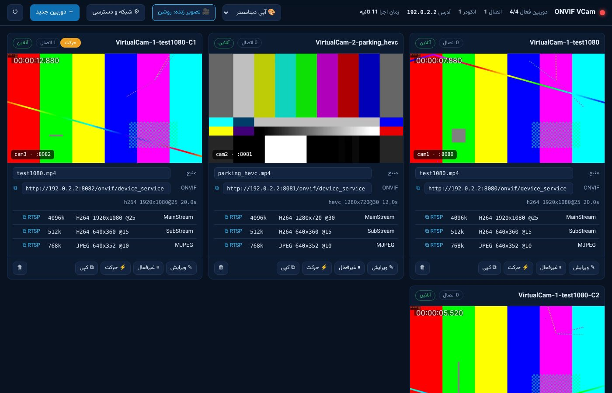
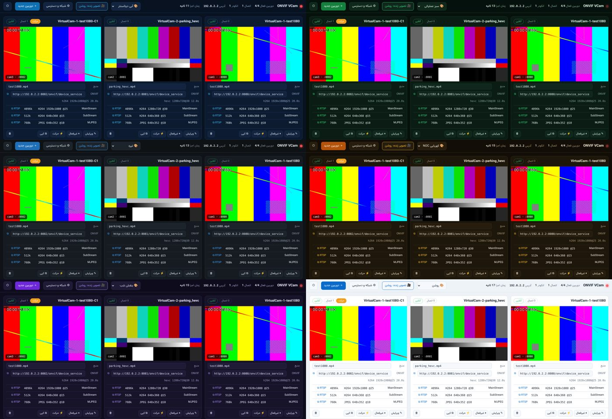

<div dir="rtl">

<p align="center"></p>

# ONVIF VCam: دوربین مجازی ONVIF برای تست VMS

**طراحی و توسعه: بهروز کاظمی** (Behrouz Kazemi): VMS Systems Specialist · **IPS-Co.** · تلگرام: [@B_8241](https://t.me/B_8241)
© 1405 — تمام حقوق محفوظ است. · [English README](README.md)

این ابزار هر فایل ویدیویی، **صفحه نمایش کامپیوتر** (همین سیستم یا کامپیوترهای دیگر شبکه) یا **وب‌کم / دوربین USB** را به یک دوربین تحت شبکه استاندارد ONVIF (Profile S و T) تبدیل می‌کند.
نرم‌افزارهای VMS آن را مثل یک دوربین واقعی پیدا می‌کنند، اضافه می‌کنند، تنظیم می‌کنند، ضبط می‌کنند و رویدادهای حرکت آن را دریافت می‌کنند.
کاملاً آفلاین و پرتابل است و به نصب هیچ چیز نیاز ندارد.



## امکانات

- **ONVIF کامل:**
  - WS-Discovery
  - سرویس‌های Device، Media، Media2 (H.265) و Events
  - احراز هویت WS-UsernameToken و HTTP Digest
- **منابع تصویر:**
  - فایل ویدیو (تکرار پیوسته و بدون مکث)
  - **صفحه نمایش** (`screen://`): دسکتاپ همین سیستم همراه با نشانگر ماوس؛ ویندوز با Direct3D 11 (و GDI به‌عنوان جایگزین)
  - **چند مانیتور در یک تصویر:** `screen://all` همه مانیتورها را طبق چیدمان ویندوز در یک تصویر عریض می‌گذارد (دو مانیتور 1080p کنار هم = یک استریم 3840×1080)؛ `screen://0+1` مانیتورهای انتخابی را کنار هم می‌گذارد
  - **صفحه نمایش کامپیوترهای دیگر** (`agent://`): ایجنت روی کامپیوتر دیگر به‌صورت سرویس نصب می‌شود، سرور را در شبکه پیدا می‌کند و در پنل ثبت می‌شود
  - **وب‌کم و دوربین USB / کارت کپچر** (`webcam://`): ویندوز با Media Foundation (و KS / DirectShow)، لینوکس با V4L2
  - استریم RTSP/HTTP یک دوربین واقعی
- **موتور استریم GStreamer** (پیش‌فرض): برای هر منبع یک پروسه که فقط یک بار فایل را دیکد یا تصویر را ضبط می‌کند و همه استریم‌های آن دوربین (اصلی، فرعی، MJPEG و اسنپ‌شات) از آن تغذیه می‌شوند؛ پس همه استریم‌ها یک لحظه را نشان می‌دهند. موتور قبلی ffmpeg هم قابل انتخاب است.
- **استریم:**
  - کدک‌ها: H.264، H.265 و MJPEG
  - انتقال RTSP روی UDP، TCP، تونل HTTP و Multicast
  - بازپخش دوربین واقعی (RTSP relay)
- **رویداد حرکت شبیه‌سازی‌شده:** زمان‌بندی‌شده یا دستی
- **تست بار:**
  - ساخت N کپی از هر دوربین، هر کدام دستگاه ONVIF مستقل
  - انکودر مشترک: ۲۰ بیننده = یک انکودر
- **پایداری:**
  - تنظیم دوباره توسط VMS استریم را قطع نمی‌کند
  - نگهبان انکودر، انکودر یا منبع هنگ‌کرده (مثلاً وب‌کم جدا شده) را ری‌استارت می‌کند
  - پشتیبانی از چند کارت شبکه و NAT
- **پنل مدیریت وب** فارسی با فونت وزیر:
  - ۶ تم رنگی
  - تصویر زنده با کلید روشن/خاموش
  - آپلود ویدیو
  - انتخاب منبع: فایل، صفحه نمایش (با انتخاب مانیتور و FPS)، وب‌کم (فهرست خودکار دستگاه‌ها) یا آدرس شبکه
  - مانیتور اتصال‌ها و لاگ زنده
- **سرویس ویندوز + آیکون کنار ساعت:** اجرا با روشن شدن ویندوز (حتی قبل از ورود کاربر) و مدیریت (شروع / توقف / راه‌اندازی مجدد) از آیکون کنار ساعت
- **بسته پرتابل ویندوز:** اجرا در پس‌زمینه بدون پنجره، تنظیم فایروال با یک کلیک



## دانلود

فایل **ONVIF-VCam-1.3.0-Portable-win64.zip** را از بخش [Releases](../../releases) دانلود کنید.

```text
ONVIF Virtual Camera 1.3.0 - نسخه پرتابل و آفلاین (Windows 64-bit)
================================================================
طراحی و توسعه: بهروز کاظمی (Behrouz Kazemi) - VMS Systems Specialist
IPS-Co.  ·  تلگرام: @B_8241
© 1405 — تمام حقوق محفوظ است.


کاملاً مستقل: پایتون، GStreamer (موتور استریم، ضبط صفحه و وب‌کم)، ffmpeg، فونت وزیر و همه کتابخانه‌ها داخل همین پوشه‌اند.
منبع هر دوربین می‌تواند فایل ویدیو، صفحه نمایش (screen://، چند مانیتور در یک تصویر: screen://all)،
صفحه نمایش یک کامپیوتر دیگر با ایجنت (agent://)، وب‌کم / دوربین USB (webcam://) یا آدرس RTSP باشد.
به نصب و اینترنت نیاز ندارد.

فایل‌ها
-------
  START.bat            اجرا در پس‌زمینه (بدون پنجره کنسول) و باز شدن پنل مدیریت
  STOP.bat             خاموش کردن (یا دکمه ⏻ در پنل)
  START-DEBUG.bat      اجرا با پنجره کنسول و لاگ کامل، برای عیب‌یابی
  SERVICE-INSTALL.bat  نصب به‌عنوان سرویس ویندوز + آیکون کنار ساعت (Run as administrator)
  SERVICE-UNINSTALL.bat حذف سرویس
  TRAY.bat             اجرای دستی آیکون کنار ساعت
  AGENT-INSTALL.bat    روی کامپیوتر دیگر: نصب ایجنت صفحه نمایش به‌صورت سرویس (Run as administrator)
  AGENT-UNINSTALL.bat  حذف ایجنت
  AGENT-RUN.bat        اجرای ایجنت در یک پنجره برای تست سریع
  AUTOSTART-ON.bat     اجرای خودکار پس از ورود به ویندوز (روش جایگزین سرویس)
  AUTOSTART-OFF.bat    حذف اجرای خودکار
  FIREWALL.bat         باز کردن فایروال (یک بار، Run as administrator)
  TEST.bat             تست خودکار (40 + 59 + 26 چک) - وقتی برنامه در حال اجراست
  SHELL.bat            خط فرمان با python / ffmpeg / ffprobe / ffplay / gst-launch-1.0 / gst-device-monitor-1.0
  PANEL.url            میانبر پنل:  http://127.0.0.1:8000
  vcam.log             لاگ (خودکار در 4 فایل 5 مگابایتی می‌چرخد)
  config.json          تنظیمات دوربین‌ها (پنل خودش ذخیره می‌کند)
  videos\              کتابخانه ویدیو

شروع
----
1. پوشه را در یک مسیر کوتاه کپی کنید (مثلاً C:\ONVIF-VCam).
2. FIREWALL.bat را یک بار با Run as administrator اجرا کنید.
   (اگر از نسخه قبلی آپدیت می‌کنید هم دوباره اجرا کنید: pythonw.exe قانون جدا لازم دارد.)
3. START.bat: برنامه بدون پنجره اجرا می‌شود و پنل در مرورگر باز می‌شود (admin / admin).
   اگر دوباره START.bat را بزنید، نسخه دوم اجرا نمی‌شود و فقط پنل باز می‌شود.
   اگر اجرا با خطا مواجه شود، یک پیغام ویندوزی علت را نشان می‌دهد.

پنل مدیریت
----------
- نوار بالا:
  - تم رنگی: آبی دیتاسنتر، سبز عملیاتی، تیره، کهربایی NOC، بنفش شب، روشن
  - تصویر زنده روشن/خاموش: خاموش = هیچ پردازشی برای پیش‌نمایش انجام نمی‌شود
  - شبکه و دسترسی
  - دوربین جدید
  - ⏻ خاموش کردن سرور
- روی هر دوربین:
  - ویرایش، فعال/غیرفعال، ارسال رویداد حرکت، حذف
  - ⧉ کپی: ساخت N کپی برای تست بار؛ هر کپی دستگاه ONVIF مستقل با پورت و UUID جداست
- تب‌های پایین صفحه:
  - اتصال‌های فعال (با نام نرم‌افزار VMS)
  - انکودرها
  - لاگ زنده

عملکرد و پایداری
----------------
- انکودر مشترک: کپی‌های یک دوربین (و هر دوربینی که همان فایل با همان تنظیمات را دارد)
  از یک انکودر استفاده می‌کنند. 20 بیننده روی 20 کپی = یک انکودر.
  برای تست بار، صدها دستگاه با مصرف CPU تقریباً ثابت ممکن است.
- نگهبان انکودر: اگر ffmpeg بیش از 10 ثانیه فریم تولید نکند (مثلاً منبع RTSP قطع شود)،
  خودکار ری‌استارت می‌شود و بیننده‌ها وصل می‌مانند.
- تنظیم دوباره همان مقادیر توسط VMS، استریم را قطع نمی‌کند.
- اگر سیستم چند کارت شبکه دارد، در «شبکه و دسترسی» IP شبکه VMS را انتخاب کنید.
- اگر VMS داخل Docker یا ماشین مجازی با NAT است، در VMS انتقال TCP را انتخاب کنید.

سرویس ویندوز و آیکون کنار ساعت
------------------------------
- SERVICE-INSTALL.bat را با Run as administrator اجرا کنید: برنامه با روشن شدن ویندوز (حتی قبل از ورود کاربر) اجرا می‌شود.
- آیکون کنار ساعت: رنگی = در حال اجرا، خاکستری = متوقف. منو: پنل، شروع / توقف / راه‌اندازی مجدد، لاگ.
- دوربین‌های صفحه نمایش و وب‌کم در نشست کاربر واردشده ضبط می‌شوند؛ تا کسی وارد نشده منتظر می‌مانند.
- START.bat و STOP.bat بعد از نصب سرویس، همان سرویس را روشن / خاموش می‌کنند.

صفحه نمایش کامپیوترهای دیگر (ایجنت)
-----------------------------------
1. همین پوشه را روی کامپیوتر دیگر کپی و AGENT-INSTALL.bat را با Run as administrator اجرا کنید.
   IP این سرور را وارد کنید (یا Enter برای پیدا کردن خودکار در شبکه).
2. آن کامپیوتر در پنل، تب «ایجنت‌ها» با مانیتورهایش ظاهر می‌شود.
3. «+ مانیتور» یا «+ همه مانیتورها» را بزنید تا دوربین ONVIF ساخته شود.
   ایجنت خودش به سرور وصل می‌شود؛ روی کامپیوتر مقصد پورت ورودی لازم نیست. روی سرور پورت 8600 باز باشد.

پورت‌ها
-------
  پنل: 8000 · ONVIF: 8080، 8081، ... (هر دوربین یکی) · RTSP: 8554 (اگر گرفته باشد خودکار پورت دیگر)
  WS-Discovery: UDP 3702 · RTP/UDP: 50000-59999 · ایجنت: TCP/UDP 8600

عیب‌یابی
--------
- مشکل دارید؟ STOP.bat و بعد START-DEBUG.bat تا همه چیز را در کنسول ببینید.
  یا vcam.log را بفرستید.
- خطای WinError 10013 یا 10048 (پورت گرفته شده توسط برنامه دیگر یا رزرو ویندوز):
  از نسخه 1.1.1 برنامه خودش پورت آزاد انتخاب می‌کند (RTSP: 18554 ...، HTTP: 8081 ...)
  و پورت جدید را در vcam.log و پنل نشان می‌دهد. دوربین را در VMS با همان پورت اضافه کنید.
  بررسی:  netstat -ano | findstr :8554
          netsh interface ipv4 show excludedportrange protocol=tcp
- ضبط صفحه در RDP: فقط وقتی پنجره RDP باز است کار می‌کند (Minimize = تصویر ثابت). به‌صورت سرویس ویندوز کار نمی‌کند.
- وب‌کم پیدا نمی‌شود: در پنل «جستجوی دوباره» را بزنید؛ در Settings > Privacy > Camera دسترسی برنامه‌های دسکتاپ را روشن کنید.
- SmartScreen: More info > Run anyway (یا قبل از Extract: zip > Properties > Unblock).
- بازگشت به حالت اولیه: config.json و پوشه vcam-state را پاک کنید.

مجوزها: GStreamer (LGPL/GPL)، ffmpeg (GPL)، Python (PSF)، PyGObject (LGPL)، فونت وزیرمتن (SIL OFL) - app\vcam\web\fonts
```

</div>

## صفحه نمایش و وب‌کم به‌عنوان دوربین ONVIF

در پنل، «دوربین جدید» را بزنید و در بخش «منبع تصویر» یکی را انتخاب کنید:

- **🖥 صفحه نمایش:** مانیتور (نمایشگر اصلی یا هر مانیتور دیگر) و FPS ضبط را انتخاب کنید.
- **📷 وب‌کم / دوربین USB:** دوربین‌های متصل خودکار فهرست می‌شوند؛ اگر دوربین را بعداً وصل کردید «جستجوی دوباره» را بزنید.

| منبع | معنی |
|---|---|
| `screen://` | مانیتور اصلی، 25 فریم بر ثانیه |
| `screen://1?fps=15` | مانیتور دوم با 15 فریم بر ثانیه |
| `screen://all` | همه مانیتورها در یک تصویر، طبق چیدمان ویندوز |
| `screen://0+1` | مانیتور 0 و 1 کنار هم |
| `webcam://0` | اولین وب‌کم |
| `webcam://Logitech C920` | وب‌کمی که نامش شامل این عبارت است |

نکته‌ها:
- رزولوشن‌هایی که به VMS پیشنهاد می‌شود بر اساس اندازه تصویر ضبط‌شده است (مثلاً 1080p، 720p، 360p برای صفحه 1920×1080).
- هر وب‌کم فقط یک بار باز می‌شود، حتی با استریم اصلی + فرعی + MJPEG + اسنپ‌شات و هر تعداد کپی.
- ضبط صفحه به یک کاربر واردشده نیاز دارد. وقتی برنامه به‌صورت سرویس اجرا می‌شود، ضبط در نشست همان کاربر انجام می‌شود (سرویس‌ها در Session 0 صفحه را نمی‌بینند)؛ قبل از ورود کاربر، دوربین‌های صفحه منتظر می‌مانند و بعد از ورود خودکار شروع می‌شوند. در RDP فقط وقتی پنجره RDP باز است (نه Minimize) تصویر به‌روز می‌شود.
- H.264 و MJPEG توسط GStreamer انکود می‌شوند. برای H.265، تصویر توسط GStreamer آماده و با libx265 (ffmpeg داخل بسته) انکود می‌شود، چون GStreamer انکودر نرم‌افزاری H.265 ندارد.
- حالت `copy` برای صفحه و وب‌کم معنی ندارد و نادیده گرفته می‌شود.
- از خط فرمان: `python -m vcam screen://` یا `python -m vcam webcam://0`؛ فهرست دستگاه‌ها: `python -m vcam --list-devices`.

## سرویس ویندوز و آیکون کنار ساعت

**SERVICE-INSTALL.bat** را با Run as administrator اجرا کنید:

- سرویس `ONVIF-VCam` با روشن شدن ویندوز اجرا می‌شود (حتی قبل از ورود کاربر) و در صورت خطا خودکار دوباره شروع می‌شود.
- آیکون کنار ساعت برای همه کاربران: رنگی = در حال اجرا، خاکستری = متوقف. منو: باز کردن پنل، شروع / توقف / راه‌اندازی مجدد سرویس، شروع / توقف ایجنت، لاگ، پوشه برنامه. کاربران عادی هم بدون دسترسی ادمین می‌توانند سرویس را روشن / خاموش کنند.
- دوربین‌های صفحه نمایش و وب‌کم در نشست کاربر واردشده ضبط می‌شوند.
- START.bat و STOP.bat بعد از نصب سرویس، همان سرویس را روشن / خاموش می‌کنند. حذف: SERVICE-UNINSTALL.bat (تنظیمات و ویدیوها می‌مانند).

## صفحه نمایش کامپیوترهای دیگر (ایجنت)

```
  کامپیوتر دیگر (سرویس ایجنت)                    سرور VCam
  صفحه -> GStreamer H.264 / MPEG-TS  ──TCP 8600 (خروجی)──>  هاب ایجنت -> یک بار دیکد ->
                                                            اصلی / فرعی / MJPEG / اسنپ‌شات -> VMS
```

1. همین پوشه را روی کامپیوتر دیگر کپی کنید و **AGENT-INSTALL.bat** را با Run as administrator اجرا کنید. IP سرور را وارد کنید (یا Enter برای پیدا کردن خودکار) و اگر در پنل کلید ایجنت تنظیم کرده‌اید، همان را وارد کنید.
2. ایجنت به‌صورت سرویس اجرا می‌شود و آن کامپیوتر در پنل، تب **«ایجنت‌ها»** با فهرست مانیتورهایش ظاهر می‌شود.
3. **«+ مانیتور N»** یا **«+ همه مانیتورها»** را بزنید، یا در ویرایشگر دوربین منبع «صفحه کامپیوتر دیگر (ایجنت)» را انتخاب کنید.

نکته‌ها:
- ایجنت خودش به سرور وصل می‌شود؛ روی کامپیوتر مقصد پورت ورودی لازم نیست. روی سرور TCP 8600 (و UDP 8600 برای پیدا کردن خودکار) باید باز باشد.
- **کلید ایجنت** (پنل ← شبکه و دسترسی): اگر تنظیم شود فقط ایجنت‌هایی که همان کلید را دارند پذیرفته می‌شوند. خود کلید از شبکه عبور نمی‌کند (challenge/response با HMAC-SHA256).
- تصویر با رزولوشن کامل و FPS دوربین ارسال می‌شود (پیش‌فرض 6 مگابیت) و سرور آن را برای هر پروفایلی که VMS بخواهد انکود می‌کند.
- ضبط تا وقتی کاربری روی آن کامپیوتر وارد شده انجام می‌شود. اگر ایجنت قطع شود، دوربین‌هایش خودکار دوباره وصل می‌شوند.

## عیب‌یابی: خطای `WinError 10013` یا `WinError 10048`

اگر هنگام اجرا پیغام `PermissionError: [WinError 10013] ...` یا `[WinError 10048] Only one usage of each socket address ...` دیدید،
یعنی پورت‌های پیش‌فرض (RTSP: **8554** و ONVIF HTTP: **8080** به بعد) روی آن سیستم توسط برنامه دیگری
(نرم‌افزار VMS / NVR، IIS، MediaMTX، go2rtc و ...) گرفته شده یا ویندوز آن‌ها را رزرو کرده است (Hyper-V، WSL، Docker).

**در نسخه 1.1.1 رفع شده است.** برنامه خودش پورت آزاد دیگری انتخاب می‌کند و در لاگ می‌نویسد:

```
WARNING vcam.rtsp   RTSP port 8554 unavailable, using 18554 instead
WARNING vcam.soap   cam1: HTTP port 8080 unavailable, using 8081 instead
```

- پورت RTSP به ترتیب 18554، 28554، 38554 و 554 امتحان می‌شود. VMS آدرس استریم را از خود دوربین می‌گیرد، پس تغییری لازم نیست.
- پورت HTTP دوربین به اولین پورت آزاد بعدی می‌رود و **در `config.json` ذخیره می‌شود** تا آدرس دوربین ثابت بماند.
  دوربین را در VMS با پورتی که در پنل یا `vcam.log` نمایش داده می‌شود اضافه کنید (جستجوی خودکار ONVIF آدرس درست را می‌دهد).
- اگر هنوز نسخه 1.1.0 دارید: نسخه 1.1.1 را دانلود کنید (`config.json` و پوشه `videos` را نگه دارید)،
  یا در `config.json` پورت‌ها را دستی عوض کنید: `"rtsp_port": 18554` و `"http_port_base": 18080`.

برای پیدا کردن برنامه‌ای که پورت را گرفته (در cmd):

```
netstat -ano | findstr :8554
tasklist /fi "PID eq <pid>"
netsh interface ipv4 show excludedportrange protocol=tcp
```

پورت پنل (8000) خودکار عوض نمی‌شود چون `PANEL.url` به آن اشاره دارد؛ اگر گرفته شده بود `ui_port` را در `config.json` تغییر دهید.
